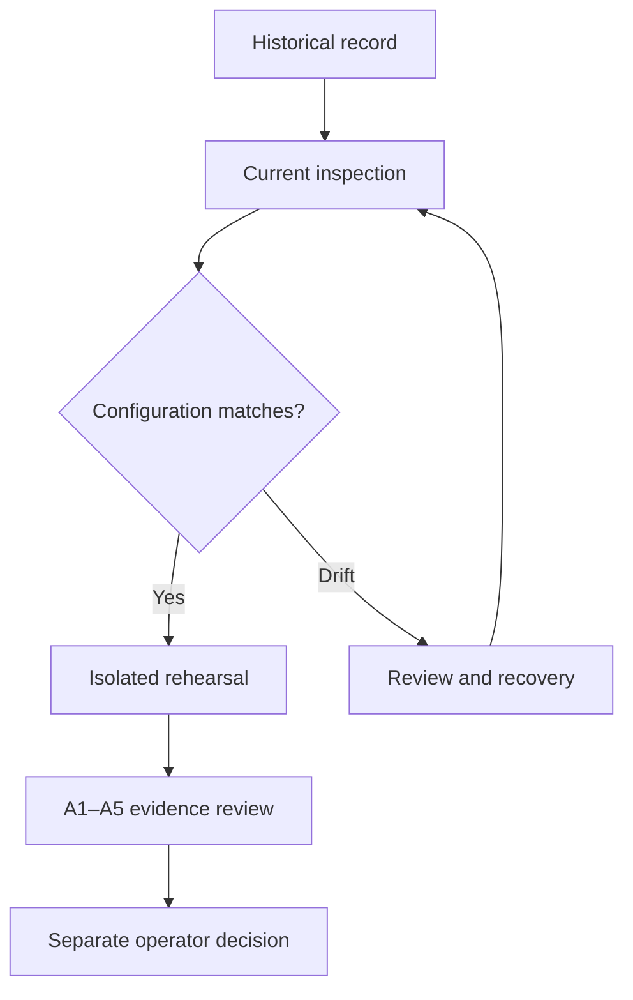

# Mainnet records and instance-specific operations

## Latest reported Manager — 17 October 2026

The [latest Manager and authority record](../deployments/MAINNET_MANAGER_2026-10-17.md) identifies Manager `0x3a9B3A0712e066de4265404Fa5ff4171fE29a3F8`, governor `0xd76AD27a1Bcf8652e7e46BE603FA742FD1c10A99` and nine reported finalized creations. At the recorded block **26,214,525**, intake was paused and identity configuration was unlocked. The record distinguishes six Exact Matches from three retained Similar Matches and establishes no ENS-helper attachment for this Manager. It is owner-reported dated evidence, not a live state query. Use this instance's original source, plan and journals, then the [readiness and operations section](../DEPLOYMENT/OWNER_MAINNET_DEPLOYMENT_AND_OPERATIONS_GUIDE.md#6-readiness-and-activation). The creation sections are for a separately authorized new deployment; do not repeat them for this already deployed Manager.

## Historical Manager and ENS helper — 10 October 2026

**The commands and authority table below apply only to `recorded-2026-10-10`: Manager `0xCFA78f9980eA9B55c705B3E44467baE383cE1fA7` and its recorded helper.** They do not inspect the October 17 Manager. Keep each instance's source, authority, namespace and evidence separate.

The manager and ENS helper were deployed and connected at block **26,165,026**.
**Activation is held pending separate review.** Start with inspection; successful
checks say “existing helper verified/connected; no deployment needed.”
The dated record is not a live status feed or the console's transaction default.

| Starting point | First action |
| --- | --- |
| Existing-instance operator | Use the read-only commands below; preserve the original deployment workspace |
| Developer | Fresh engineering checkout, Node 22.23.2, `npm ci`, `npm --prefix hardhat ci`, then `npm --prefix hardhat run test:preflight` |
| New operator | Use the [deployment guide](../../hardhat/README.md) with explicitly reviewed addresses and a separate namespace |
| Demo visitor | [Prepare a request](https://montrealai.github.io/AGIJobManager/employers/); no wallet or payment is needed to draft |



## Roles and authority

A merge validates the website without publishing it. Production Pages requires a
separate manual GitHub Pages dispatch with `publish: true` and `source_commit` set
to the exact reviewed main SHA. Review that revision's applicable checks first.
The default dispatch only validates. Release publication and intake authority are
separate from both operations.

| Role | Recorded address / responsibility |
| --- | --- |
| Manager and helper administrator | `0xa9eD0539c2fbc5C6BC15a2E168bd9BCd07c01201`; manager uses transfer **and acceptance**, helper uses one-step transfer |
| Shared ENS-root wallet | `0xd57243B80FBc5CFB2560E5a644651FEcd7Dc2512`; retains USDC and alpha roots; NameWrapper approval is wallet-wide |
| Historical deployer | `0x6c8B8897Fb6b08B4070387233B89b3E9A94eD00E`; its completed transactions are not new deployment instructions |
| Paid-work employer, agent and non-conflicted moderator | Still operator inputs; administrative signing does not establish these participants |
| Incident responder | Reviewed, funded signing capability and an exercised alert-to-response procedure are still required |

## Prepare a read-only shell

Use a **fresh engineering checkout**, not `~/AGIJobManager-deploy-A`. Install the
committed dependencies with Node 22.23.2. Do not copy private keys or deployment
`.env` files into it. Commands do not load dotenv. Set `MAINNET_RPC_URL` privately
in this shell to a reviewed HTTPS endpoint. Never put an endpoint containing a
credential in a command shared publicly.

The launcher rejects `NODE_OPTIONS`, `NODE_PATH`, `PRIVATE_KEY` and
`DEPLOY_CONFIRM_MAINNET`. Review and remove inherited startup controls in a clean
shell before invoking npm; npm itself is a Node process. A later JavaScript check
cannot undo a preload that already ran. No command below contains a signing API.

From the **repository root**, create a new private report directory:

```bash
mkdir -m 700 "$HOME/agi-readiness-review"
npm run mainnet:evidence
npm run mainnet:inspect -- --help
npm run ens:inspect -- --instance recorded-2026-10-10 --out "$HOME/agi-readiness-review/ens.json"
```

The directory must not already exist for the `mkdir` example. Choose a new name
for each review. `mainnet:evidence` is offline and validates the preserved record.
`ens:inspect` uses read-only RPC, requires the explicit instance selection and
checks current connection/authority at one canonical block. It does not refresh
financial state. Missing approval-history input is reported as NOT_RUN.

## One coherent current observation

From the **repository root**, with the HTTPS RPC configured:

```bash
npm run mainnet:inspect -- --instance recorded-2026-10-10 --out "$HOME/agi-readiness-review/current.json"
```

This collects core limits, all five reserves, native USDC balance and issuer
restrictions, implementation identity, membership roots and ENS state at the
**same EIP-1898 canonical block hash**. The final block/chain recheck rejects a
reorg. An endpoint without canonical-hash support must be replaced; no numeric
fallback is used. It records single-provider reliance without claiming independent
infrastructure. A latest block more than 15 minutes old is rejected.

Without a reviewed build, complete NFT enumeration remains NOT_RUN, making the
combined result NEEDS_OPERATOR_INPUT. Do not interpret that as an empty registry.
To prepare the build input offline, identify the actual saved manager artifact,
its matching Hardhat build input/output files, and original manager receipt:

```bash
node scripts/commissioning/export-build.cjs --artifact /private/AGIJobManager.json --build-input /private/build.json --build-output /private/build.output.json --receipt /private/manager-receipt.json --out "$HOME/agi-readiness-review/build.json"
```

`/private/...` paths are placeholders for **your intact original files**, not
files included with the release. The exporter only creates a private bundle;
inspection replays the pinned compiler, validates storage layout, reconstructs
runtime with the reviewed links and reads every registry entry including disabled
collections. Do not fabricate missing original artifacts.

For the full read-only collection, supply the bundle, approval-history start block
and comma-separated real participant addresses:

```bash
npm run mainnet:inspect -- --instance recorded-2026-10-10 --build "$HOME/agi-readiness-review/build.json" --approval-start 0 --participants 0xEMPLOYER,0xAGENT,0xMODERATOR --out "$HOME/agi-readiness-review/complete.json"
```

Replace all three address placeholders. A start block of zero requests history
from genesis; a later start intentionally yields a bounded, incomplete historical
inventory. Ranges contain at most 5,000 blocks, split again when the response hits
the log cap. Missing ranges, duplicates, malformed logs, removed logs, reorgs,
active-state disagreement or provider rejection stop the inventory. Silent provider
omission cannot be proved absent by pagination. Review that limitation and each
active operator's control separately. Wallet-wide operators, renewal managers and
child-resolver delegates are different authorities.

## Rehearse without touching the public chain

From the **repository root**, use a fresh current observation and the clean matching
source checkout with compiled artifacts:

```bash
npm run ens:rehearse -- --instance recorded-2026-10-10 --input "$HOME/agi-readiness-review/complete.json" --out "$HOME/agi-readiness-review/rehearsal.json"
```

This creates a private temporary project outside the checkout, resolves one
coherent installed Hardhat/plugin/ethers runtime, and uses only its exact loopback
read proxy. It connects only to an in-process chain 31337 at the reviewed fork
block. It reuses the already connected helper; no helper is redeployed even in this
rehearsal. Local impersonation, USDC minting and the agent allowlist are explicitly
synthetic fixtures. Create, assignment, completion, buyer acceptance, cancellation,
ENS records and terminal delegation are checked, including pausing after assignment.
The installed helper build is replayed; this is not a claim to reproduce unavailable
original operator-cache bytes. Native contract tests separately cover disputes,
expiry, deferred claims, moderator conflicts and reviewer allocations.

A missing artifact, unavailable archive block, stopped child, timeout, transport
rejection or upstream failure cannot produce PASS. The parent verdict controls;
a passing child cannot override it. Preserve the private result. Do not fix a
transport rejection by permitting arbitrary RPC methods.

## Recover completed work

From the **repository root**, use the original private helper journal:

```bash
npm run ens:recover -- --instance recorded-2026-10-10 --journal /private/DEPLOYMENT_REVIEW.json --artifact /private/ENSJobPages.json --out "$HOME/agi-readiness-review/recovery.json"
```

This read-only mode binds the exact historical journal, compares transactions,
receipts, sender/target/calldata, creation nonce/address, constructor encoding,
canonical blocks and current runtime. It never rewrites the journal or obtains a
new nonce. Missing/ambiguous receipts and consumed nonces stop for reconciliation.
Explorer verification remains separately identified as historical; a runtime match
or generic “already verified” answer is not fresh exact-source verification. Use
[verification recovery](../../hardhat/README.md) with original compiler inputs.

| Namespace mode | Required route |
| --- | --- |
| Recorded commissioned instance | Inspect/recover; never start fresh deployment |
| Fresh isolated namespace | Existing generic fresh-mode safeguards and explicit new manager |
| Existing wallet-held root | Preserve custody; reviewed root authority and dedicated helper plan; never recreate/unwrap/transfer the root automatically |
| Same-manager helper replacement | Existing replacement-mode checks, historical label inventory and separately authorized cutover |

## Collect the five activation groups

From the **repository root**; these commands are offline:

```bash
npm run activation:review -- --template
npm run activation:review -- --input /private/activation-input.json --out "$HOME/agi-readiness-review/activation-review.json"
```

The first command prints the blank schema; save the JSON in a private file without
npm's banner (use `bash scripts/commissioning/command.sh activation --template > /private/activation-input.json`).
Fill A1–A5 with actual decisions and safe private evidence references. Each reference
has `reference`, `sha256` and `reviewer`; use identifiers, not secret material.
Observation/rehearsal files must match their SHA-256 references and source identity.
The rehearsal must reference that exact observation and block; collect a new pair
if either is stale or has changed. A stopped child outcome overrides any PASS label.
A complete collection still requires a **separate signed, versioned owner decision**
with reviewer, scope, evidence and approval. The command never authorizes intake.
See [the finite operator actions](../../OPERATOR_ACTIONS_REQUIRED.md).

| Exit | Meaning / next step |
| --- | --- |
| 0 | The requested narrow check passed, or a template/help was printed; inspect scope |
| 1 | A check failed; use the fixed phase/code and review the drift or recovery evidence |
| 2 | Setup/input/module/filesystem failure; fix the named input in the fresh checkout |
| 3 | Missing evidence, operator input, or complete collection awaiting separate approval |

Reports are append-only observations: new names, exclusive mode-600 files in a
mode-700 owned directory. Do not upload original private reports or the handoff ZIP
wholesale. Public summaries should contain safe status, source/block identities and
reviewed input hashes. Re-running changes neither history nor wallet authority.

The rehearsal fingerprints complete installed root and Hardhat-subproject dependency
trees, including secondary modules and native binaries, before and after execution.
External package-file symlinks and oversized inventories stop the check; symlinked
installation roots are supported. This proves continuity with the initial installed
bytes, not their authenticity: use the pinned lockfiles in a fresh engineering checkout.

The same aliases exist from `hardhat/` (for example `npm run ens:inspect -- ...`).
Use absolute private paths when using `npm --prefix hardhat`, whose process directory
is the subproject. `--help` needs neither credentials nor a wallet.

## New or replacement namespace planning

From the repository root, `npm run ens:plan -- --input /private/namespace-plan.json --out /private/new-plan.json` performs read-only mainnet precondition checks. Use a mode-700 output directory and the same HTTPS RPC setting. The private JSON has `schema: "agijobmanager-ens-namespace-plan-v1"`, `mode` (`fresh`, `existing-root` or `replacement`) and an explicit `manager`. Existing-root mode additionally requires the normalized `rootName` and `rootOwner`. Replacement derives the current helper namespace and preserves its prefix; fresh mode reuses the maintained manager-specific namespace derivation. A plan cannot authorize deployment. The recorded commissioned instance uses `ens:inspect` instead.

## URI length and ENS gas limits

The native regression in `test/ensHooks.integration.test.js` exercises the permitted
2,048-byte specification and 1,024-byte completion URI limits under a 3,000,000-gas
transaction bound. With the test resolver, the manager's 500,000-gas ENS hook budget
cannot mirror those long records: the outer hook reports success while the helper
emits `ENSHookBestEffortFailure` and the resolver record remains empty. Cancellation,
settlement, completion NFT issuance and zero final reserves are checked separately.

This is a reproduced operating constraint, not a new contract change. The operator
and reviewer should include actual URI lengths and resolver/gas behavior in the
existing A3 success/adverse-path review. Rehearse that input profile and inspect both
layers of events plus actual records. The connected-mainnet fork command uses short
synthetic URIs; it does not certify every permitted URI length or resolver.
