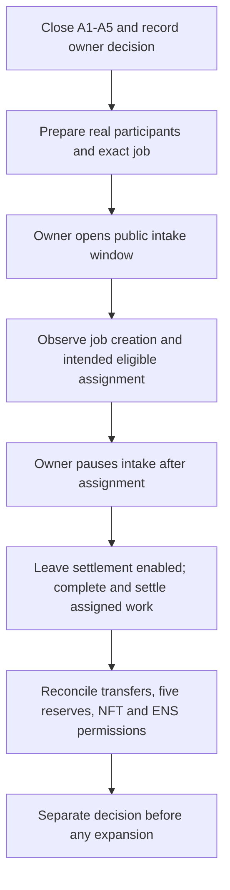

# Production activation — separate from ENS commissioning

**Review dated 10 October 2026: HOLD INTAKE ACTIVATION.** The [recorded Ethereum mainnet instance](../deployments/MAINNET_USDC_2026-10-10.md) has completed its ENS deployment and connection milestone. This review does not reopen that work, claim a newly discovered fund-loss exploit, or authorize transactions. It is an internal source/evidence review, not an independent security audit or a live financial inspection.

[Machine-readable decision and evidence](../../config/mainnet/agi-jobs-usdc.json) · [Full launch checklist](../LAUNCH_CHECKLIST.md) · [Incident response](INCIDENT_RESPONSE.md)

## What is already established

The supplied evidence records an exact helper compiler replay and 18 selected fork checks, actual verified helper deployment, two owner-signed approval/attachment transactions and ten connection checks at block **26,165,026**. Administrative signing is evidenced; it is not correct to describe all real-wallet control as unproven. The intended paid-work participants, their funding and their response coverage remain separate questions.

The earlier core-readiness snapshot is block **26,161,848**. A later connection-only pass does not refresh its financial, complete NFT-registry or mutable-policy findings. Keep original reports unchanged and add subsequent reports with their own blocks, source identities and scopes.

## Five finite closeout groups

| Gate | Recorded status | Closure evidence |
| --- | --- | --- |
| A1 — Launch scope and limits | OPEN_POLICY_DECISION | Explicitly approve the public-admission window and chosen payout, duration, bond/timer and per-agent settings; read them back. A strict private or aggregate-limited design requires separate qualification. |
| A2 — Fresh financial and policy state | OPEN_EVIDENCE | One coherent-block readback of all five reserves, USDC balance, fee recipients, issuer restrictions/implementation, complete NFT registry, identity and mutable limits. Corroborate critical state independently where feasible, or record single-provider reliance. |
| A3 — Real participants and adverse outcomes | OPEN_EVIDENCE_AND_OPERATOR_INPUT | Actual employer, agent and credential/exception, funds and accessible signers, selected review route and available non-conflicted dispute fallback; source-bound evidence for applicable expiry, disputes, claims and recovery. |
| A4 — Privileged authority and response | OPEN_EVIDENCE | Reconcile full active operator approvals and each operator's control; document key recovery, funded response signers, retained mutable powers and demonstrated alert-to-response handling. No automatic locks or indiscriminate revocations. |
| A5 — Actual operating basis | OPEN_OPERATOR_INPUT | Adopt instance-specific operator/fee-beneficiary disclosure, scope, terms/data/IP rules and contacts; verify the actual interface/admission route and retain applicable review conclusions privately. Repository templates are not adopted agreements. |

The review does not determine a legal classification or grant an authorization. The [operator notice](../LEGAL/OPERATOR_NOTICE_TEMPLATE.md) remains a template. Do not publish privileged advice or personal identity documents as gate evidence.

## Admission is public once unpaused

In the reviewed [manager source](../../contracts/AGIJobManager.sol), `unpauseIntake()` calls `_unpause()`. It does not read readiness files. `createJob()` checks pause flags, bounds, URI and the USDC transfer; it has no employer invitation gate, aggregate escrow ceiling or system-wide one-job limit. A private UI cannot prevent direct contract calls.

`maxJobPayout` limits each job, not aggregate liabilities. `maxActiveJobsPerAgent` limits assignments per agent address, not funded unassigned jobs or other addresses. The source initializer `88888888e6` is **88,888,888 USDC per job**, a source default rather than a new live getter observation. Do not assume a proposed 100-USDC ceiling has already been applied.

The first successful eligible `applyForJob()` call assigns a job; posting does not reserve it for a nominated agent. Record the possibility of competing public transactions and inclusion/ordering delay. An attended one-job intention is not an atomic contract-enforced cap.

## Correct pause ordering



This diagram is a future operational sequence, not authorization to execute it now. `applyForJob()` requires unpaused intake, so pausing immediately after posting prevents assignment. Completion submission, voting, acceptance and settlement can continue with intake paused while settlement remains enabled. Other jobs may enter before the pause is included.

For optional ENS/provider trouble without fund or identity compromise, consider intake containment while preserving exits. For suspected exploit or compromised authorization affecting funds/votes, use the broader containment in the [incident runbook](INCIDENT_RESPONSE.md). `pauseAll()` also blocks refunds and claims and pauses lifecycle clocks; it does not remove a compromised owner. Do not use irreversible identity locking as incident response.

## Financial and payout checks

For the first-activation readiness policy, all five counters must be zero:

```text
lockedEscrow + lockedAgentBonds + lockedValidatorBonds
+ lockedDisputeBonds + lockedClaims
```

Always verify `USDC.balanceOf(manager) >=` that sum. A donation/surplus balance is not automatically insolvency. Pending claims are liabilities even after jobs complete. Source: [reserve accounting](../../contracts/AGIJobManager.sol) and [settlement library](../../contracts/utils/JobSettlement.sol).

| Successful 100-USDC example | Shared reviewer allocation | wallet30 | wallet10 | Agent, before separate bond returns |
| --- | ---: | ---: | ---: | ---: |
| Full default reviewer budget allocated | 8 | 30 | 10 | 52 |
| Buyer acceptance, zero validators | 0 | 30 | 10 | 60 |

The reviewer percentage is snapshotted per job. Eight percent is a shared budget, not a payment per reviewer. With no validators the settlement library sets the budget to zero; unused allocations and rounding may also return to the agent. Bonds, slashing, refunds and deferred claims are separate. Reconcile actual token transfers plus `pendingUSDC`/`lockedClaims`: a completion event alone does not prove every recipient received payment.

## Participants, disputes and authority

Fork-only USDC minting, impersonation and explicit test allowlists are not production credentials. Buyer acceptance is a valid success route, but it cannot substitute for a funded and non-conflicted failure/dispute fallback. Ordinary resolution checks moderator membership; manager ownership alone is not that membership. The stale-owner fallback also requires elapsed time and conflict checks. A buyer, agent, recorded voter or validator controller cannot simply ignore those restrictions. Separate addresses do not prove independent people.

The root wallet's shared use is an accepted design choice, not a new request to transfer names. NameWrapper approval is wallet-wide. The completed checks covered three historical operators plus the new helper, not the full approval history or an independent review of each operator's control. Revoking a root operator stops new names but does not automatically remove child resolver delegation. Keep these scopes explicit.

## Draft first-job profile — not approved or applied

The review proposes a **100-USDC maximum payout**, one intended concurrent job and a per-agent assignment-limit proposal of one, using an attended public-input task. Duration, employer, agent credential, moderator, incident responder and operating sign-off remain unspecified. This is neither an agreed budget nor proof that such a job economically supports paid review.

Keep the existing roots, custody, helper root/prefix, locks and token-URI settings unchanged unless a separate change is reviewed. Reconcile actual payments, reserves, completion NFT, ENS records and terminal delegate revocation before increasing exposure. A manual attended experiment does not qualify an autonomous Fleet installation.

## Preserving the decision

A passing record validator or connection checker must leave `intakeActivationAuthorized` and `productionReadinessCertified` false. These files do not prevent an owner from directly calling the contract; they are evidence and review records, not new on-chain controls. A later activation decision must identify its reviewer, approved scope, current evidence and explicit owner authorization in a separate versioned record. Do not edit historical tests or receipts into a pass.
