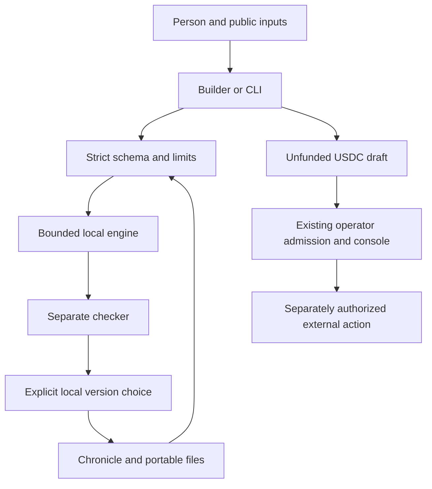

# SUCCESSOR Ω architecture and interfaces

## Trust and data flow



Text equivalent: public input is validated before a bounded engine produces files. A separate implementation checks actual bytes. A person chooses a local version and retains history. Restoration repeats validation. Optional drafts cross into the existing admission/console system only through a separate reviewed action; no path from a local check directly grants authority.

`safe.mjs`, `missions.mjs`, `checker.mjs`, `model.mjs` and `jobs.mjs` are shared browser/CLI modules. `app.mjs` owns UI and downloads. A closed-module build bundles only repository-reviewed source, not input code. Expensive run/inspection/planning operations execute in a terminated-after-10-seconds Web Worker. The source archive uses a bounded stored ZIP writer; the browser accepts JSON capsules only and never decompresses imported archives.

## Records and lifecycle

| Record or stage | Implemented representation and boundary |
| --- | --- |
| Mission dossier | `successor-mission/v1`; typed family, purpose, owner reference, rights, exact input, outputs, success, forbidden outcomes, tools, limits and recovery. Owner text is not authenticated identity. |
| Successor Options | Retain, repair, build, rent, partner, reserve and stop. Unavailable alternatives explain missing access/capacity. |
| SEIZE | Explicit selection of a bounded local repair or preparation of an unfunded improvement plan. No operational grant. |
| Mission Gym | Executable aggregate model or constrained website composition; original input and configuration frozen before execution; separate checker inspects result bytes. No neural-symbolic or general intelligence claim. |
| Candidate | Source digest, engine version, mission hash, variant, tools, empty permissions, absent provider, output hashes, observed gaps and checks. ID hashes the complete record. |
| Fresh Proof | A fresh local run and comparison on the same mission; deterministic content can repeat. Local checks are neither protected evaluation nor organizational independence. |
| Qualification and admission | Fixed `not-evaluated` and `none` in local records. Existing external qualification/action-bound operator-budget admission must establish actual scope and current rights. No Specialist ASI badge. |
| Chronicle and renewal | Append hash chain with mission, checked candidate, plan, choice, failed run and restore events. Semantic order is checked on import. Replace requires improvement; ties/regressions retain. Rollback targets a previously chosen version. |
| Portable capsule | `agijobmanager/successor-capsule/v1`; exact state, source manifest and outer checksum. All embedded artifacts and checks are reproduced with the current trusted engine. No imported executable code or permissions. |
| Improvement request | `agijobmanager/successor-improvement-draft/v1`; real employer draft/metadata/console fields, immutable input bytes, six-decimal prices and unknown costs, fixed bounds, commitment, blockers, no payment. |

A local record can be rewritten with new checksums. An independently retained checkpoint is necessary to detect that rewrite. No signature or trusted timestamp is fabricated. Saved history is historical; actual liability ownership and receipts remain with their original contracts/controllers. A failed local attempt records a stable error code rather than confidential diagnostics.

## Native USDC adapter

`prepareImprovement` calls the existing `emptyDraft`, `validateDraft`, `toMetadata`, `toConsoleDraft`, `normalizeBudget` and `splitPayment` interfaces. It does not relabel an AGIALPHA document. `compileComputerWork` consumes a separately supplied `successor-runtime-context/v1` and calls the actual `validateComputerWork` and `checkRuntime` implementations in `scripts/economics/computer-work.cjs`. Output is a real `agi-node-job/v1`, `computer-work/v2` specification with exact input hashes and byte limits, outputs/evidence, runtime digests, resources, time/cost bounds, deadline, settlement/recovery and parent plan commitment.

Runtime context includes `runtimes.agent`, `runtimes.reviewer`, `inputs`, `deadline`, `settlement`, `budget` and `publicConsent`. The passing fixture and all field names are executable in `scripts/successor/core.test.mjs`. Fixture descriptors explicitly say no model/OpenClaw installed. Format/runtime-hash validation is not proof of independent control, hosted-input byte availability, deployment correctness or admission. The adapter does not fetch URLs. An operator must fetch approved public immutable inputs with its governed fetcher and verify the supplied digest before authorizing execution. `checkNewWorkBoundary` delegates to the existing admission checker, without new policy bypasses or retainers.

`validateGraph` checks bounded stage IDs, cycles, total up-front reserve and supplied accepted downstream artifact hashes. An `independentlyAccepted` field is a claimed evidence reference, never authenticated review. The function grants no authority and performs no spending. Future execution must verify the actual acceptance provenance. Earlier jobs may settle even if a later stage fails; no atomic project settlement is implied.

The Alpha importer verifies the unchanged pinned upstream verifier and replays compilation/discovery/evaluation. It retains original raw bytes, token, eighteen-decimal historical allowance, hashes and source identity. It rejects expired rights and requires a new explicit six-decimal USDC allowance. The result is a custom mission draft with execution unavailable. Original evidence cannot qualify native USDC settlement. See vendored [provenance](../../scripts/successor/vendor/agijobsv0/provenance.json), MIT and Apache-2.0 notices.

## Headless use

Run from the repository root. Outputs refuse overwrite; use a new directory for each demonstration.

```bash
npm run successor -- example analyst build/demo/mission.json
npm run successor -- run build/demo/mission.json build/demo/unselected.json
npm run successor -- choose build/demo/unselected.json latest build/demo/selected.json
npm run successor -- plan build/demo/selected.json 100 build/demo/request.json
npm run successor -- improve build/demo/selected.json build/demo/compared.json
npm run successor -- choose build/demo/compared.json latest build/demo/improved.json
npm run successor -- inspect build/demo/improved.json
npm run successor -- export build/demo/improved.json build/demo/exported
npm run successor -- validate build/demo/exported/capsule.json
npm run successor -- restore build/demo/exported/capsule.json --confirm build/demo/restored.json
```

`improve` prints the comparison and preserves explicit version selection. `rollback INPUT CANDIDATE_HASH OUTPUT` requires a previously selected candidate. `compile DRAFT CONTEXT OUTPUT` validates the native specification. `import-alpha ORIGINAL NEW_USDC_BUDGET OUTPUT` performs the pinned import. `npm run successor:rehearse` exercises the actual authenticated browser path. Stable error codes accompany readable messages; no command interprets a user/organization label as authenticated permission. Browser operations additionally explain common errors in English/French.

## Paired computer-work rehearsal

The website has `connect-src 'none'`; it cannot contact loopback or providers. The trusted Node service in `worker.mjs` pairs a Node client using a 32-byte random secret, HMAC challenge/response, derived session key and monotonically increasing request sequence. It accepts only literal `127.0.0.1`, an exact Host header and no browser Origin/fetch metadata. Every response is authenticated. Nonces and attempted calls survive restarts in a mode-0600 fsynced hash-chain journal. A journal is locally integrity-checkable, not a remote trusted ledger. Revocation persists and stops future dispatch.

The exact supported driver is disposable Playwright Chromium with outbound networking blocked and a fixed public form fixture. Capabilities bind driver hash, Node/Playwright/browser versions, keyboard/pointer/screen support and fixture-only resources. Observations expire after five seconds; failed refresh and actions invalidate them. Only the fixture's exact fields/buttons are actionable. Calls/time/concurrency/artifact sizes are bounded; calls are counted before dispatch and timeouts revoke the session. There are no model calls, financial permissions, arbitrary URLs, native desktop access, provider keys or signer material.

`rehearse.mjs` makes actual keyboard and pointer calls, captures screenshot/output, checks the expected public result independently, tests a stale observation and stops the worker. Protocol unit tests use an explicitly named test double; the rehearsal uses a real browser. This is not measured OpenAI/OpenClaw competence. Private native companions are separately delivered and qualified; whole-account desktop access must not be described as application confinement.

## Scaling limits

Static delivery has no central application session. Hosted HTML is kept under 750 KB uncompressed by a regression gate; workers move bounded computation off the UI thread. Input/candidate/history caps bound growth. No chain-history scanning, RPC polling, indexing, paid queue or new backend is added. Browser evidence includes actual timings, HTML bytes and JS heap observations when available; these are environment-specific, not capacity claims. Before a campaign, measure representative low-end devices, download reliability, host/CDN traffic limits, provider quotas, independent reviewer capacity and settlement throughput separately. None of those is established by viewport tests or a local benchmark.
